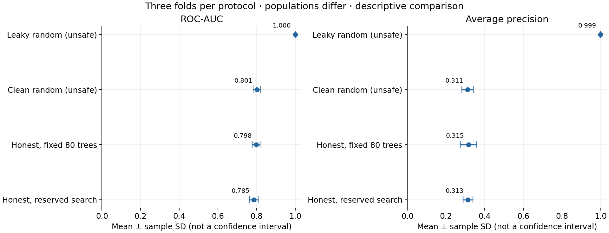
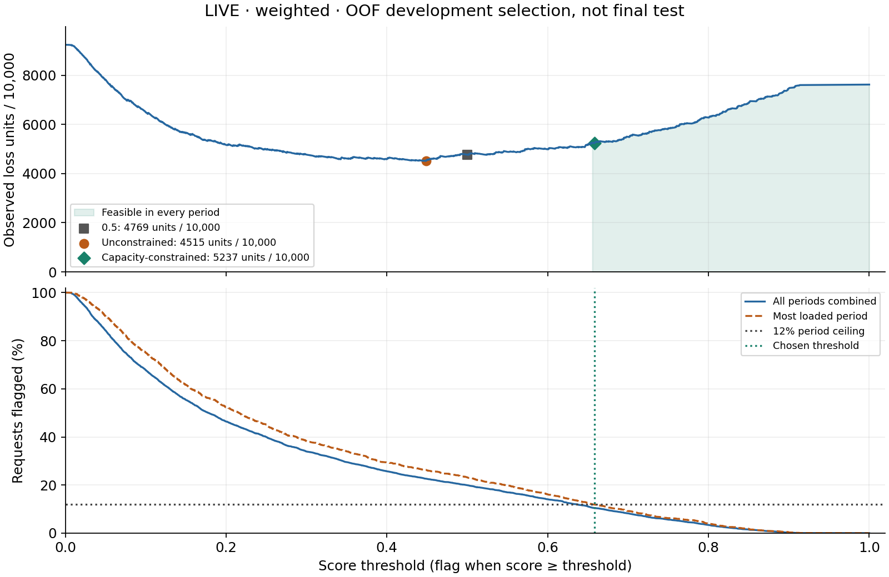
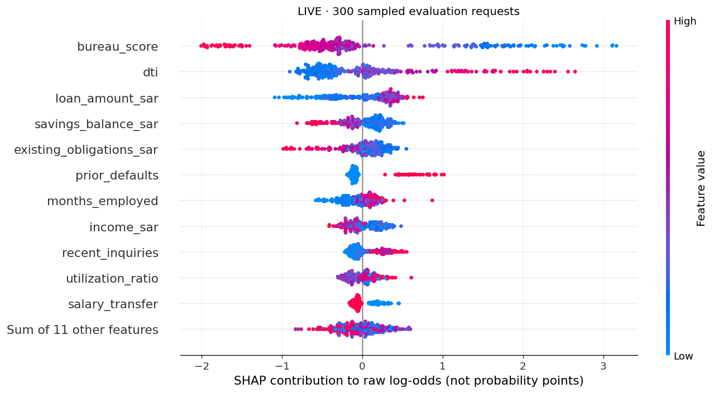
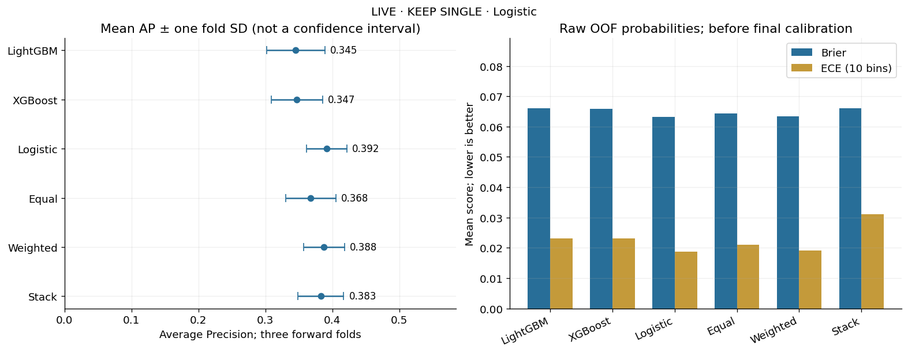

# Tamweel Lite | تمويل لايت

**Can information available at application time help rank financing requests by 90-day default risk?**

Tamweel Lite ranks 90-day default risk from synthetic financing applications. The scores help prioritize requests for simulated human review within a fixed capacity.

The final model is **Logistic Regression**. Its batch policy flagged **300 of 2,500** challenge requests for simulated review, within the **12%** limit.

[Open the executed project notebook](notebooks/delivery/NAIF_ALDOSARI_SDA_TAMWEEL_FINAL.ipynb) · [Decision notes](#project-decisions) · [Evidence and notebooks](#reproduce-and-audit) · [Figure sources](reports/FIGURES.md)

## Project workflow

| Stage | Question |
| --- | --- |
| [Setup](#readiness-and-reproduction) | Are the pinned dependencies and data ready to run? |
| [Baseline model comparison](#baseline-model-comparison) | Which of the three models is the strongest candidate on the comparison set? |
| [Time-aware validation and tuning](#time-aware-validation-and-tuning) | How do leakage, time and customer separation affect the comparison? |
| [Review policy and capacity](#review-policy-and-capacity) | How do error costs and review capacity affect the threshold? |
| [Model interpretation and calibration](#model-interpretation-and-calibration) | What drives the predictions, and how well do the probabilities reflect observed risk? |
| [Final model and inference](#final-model-and-inference) | Which model and decision policy should be exported with the documented evidence? |

## Readiness and reproduction

The readiness run passed on Colab CPU with **10,000 training applications**. The data checks and six compatibility checks passed. The setup cell at the top of the project notebook prepares the pinned package versions.

1. Open the [executed notebook in GitHub](notebooks/delivery/NAIF_ALDOSARI_SDA_TAMWEEL_FINAL.ipynb) to review its saved tables and figures.
2. Use the Colab button above, select a CPU runtime and run from the top with `FAST_MODE=True`. If the setup cell restarts the session, run from the top again.
3. Check for `TECHNICAL_READY` after the export cell. The run uses seed `211` and pinned source files. Compare the [baseline model table](artifacts/day1_model_comparison.csv), [validation summary](artifacts/validation_summary.csv), [threshold metrics](artifacts/threshold_metrics.json), [calibration metrics](artifacts/calibration_metrics.json), and [final metrics](artifacts/final_metrics.json). Training times can vary between sessions.
4. Run the last cell to check the files in this GitHub repository with Notebook 99. The cell prints the check status and saves a JSON report to Colab Files.

## Baseline model comparison

The baseline comparison used 22 approved predictors to rank applications by the risk of `default_within_90d`. The outer split reserved 8,000 applications for development and 2,000 for comparison. Inside development, 6,000 applications were used to fit the boosting models while 2,000 were used for early stopping. The selected tree counts were fixed before refitting on all 8,000 development applications.

| Model | Average Precision | ROC-AUC | Training time (s) | Selected trees |
| --- | ---: | ---: | ---: | ---: |
| Logistic Regression | 0.3258 | **0.8213** | 0.0891 | — |
| XGBoost | **0.3338** | 0.8124 | 0.4918 | 61 |
| LightGBM | 0.3248 | 0.8138 | 0.3399 | 41 |

Of the 2,000 comparison applications, 158 defaulted within the target window (**7.9%**). Average Precision focuses on how well the models retrieve this rare class across score cutoffs. ROC-AUC measures ranking across both classes. Logistic Regression led on ROC-AUC, while XGBoost led on Average Precision by 0.0080 over the baseline. Boosting times include tree selection and refitting.

### Evidence in this repository

| File | What to look for |
| --- | --- |
| [Baseline notebook](notebooks/01_baseline_boosting.ipynb) | The executed baseline and boosting comparison |
| [Model comparison](artifacts/day1_model_comparison.csv) | The three models evaluated on the same 2,000 applications |

## Time-aware validation and tuning

[Executed notebook](notebooks/02_validation_tuning.ipynb)

The validation study used LightGBM to compare four validation protocols. The feature audit identified two post-application fields, `days_past_due_60` and `collection_calls`. Removing them left 22 approved predictors. The duplicate check found zero duplicates among 10,000 applications. Each forward fold used training labels whose 90-day outcome windows closed before validation began.

| Validation start | Eligible training applications | Validation applications | Shared customers |
| --- | ---: | ---: | ---: |
| July 2023 | 3,223 | 1,632 | 0 |
| January 2024 | 4,460 | 1,674 | 0 |
| July 2024 | 5,731 | 1,733 | 0 |

Optuna completed all 8 trials on 1,935 reserved historical applications. The search excluded all outer-validation customers. Its best internal mean AP was 0.3333, with a learning rate of 0.0853 (rounded), 31 leaves, and 40 minimum child samples. Those settings were fixed before outer evaluation. Each forward run covered all 5,039 eligible validation applications, or 50.39% of the dataset.

| Validation protocol | Mean AP ± SD | Mean ROC-AUC ± SD |
| --- | ---: | ---: |
| Leaky random control | 0.9988 ± 0.0014 | 0.9999 ± 0.0002 |
| Clean random control | 0.3110 ± 0.0293 | 0.8010 ± 0.0200 |
| Time- and customer-aware, fixed LightGBM | **0.3153 ± 0.0426** | **0.7976 ± 0.0206** |
| Time- and customer-aware, tuned LightGBM | 0.3133 ± 0.0259 | 0.7855 ± 0.0232 |

The random controls show how much the evaluation changed when we removed post-application fields and fit imputation inside training. Mean AP fell from 0.9988 to 0.3110, a gap of 0.6879 calculated before rounding. The clean random and forward protocols cover different applications. Within the same three forward folds, fixed LightGBM scored slightly higher on both means, while tuned LightGBM had less AP variation. The bars show the sample standard deviation across folds.

| Evidence | What to check |
| --- | --- |
| [Leakage audit](artifacts/leakage_audit.csv) | Which fields were available when the application arrived |
| [Fold audit](artifacts/fold_audit.csv) | Three validation windows, zero shared customers and the training label cutoff |
| [Optuna trials](artifacts/optuna_results.csv) | Eight live trials and their internal fold scores |
| [Validation summary](artifacts/validation_summary.csv) | Mean and sample standard deviation for AP and ROC-AUC |

## Review policy and capacity

[Executed notebook](notebooks/03_cost_sensitive_decision.ipynb) · [Decision card](reports/DECISION_CARD.md)

The review-policy study reused the forward, customer-separated validation design. The unweighted, weighted and oversampled LightGBM variants each predicted the same 5,039 eligible applications out of fold. Defaults accounted for 7.62% of those applications. Screening nobody would reach 92.38% accuracy with zero recall. Pooled Average Precision was 0.3091, 0.3100 and 0.3159, respectively. The weighted variant was specified in advance for threshold selection.

The simulated cost model assigns ten loss units to a missed default and one to a false flag (`10 × FN + FP`). The review ceiling is 12% **in each period**. A flagged application goes to simulated review.

| Rule | Threshold (rounded) | Reviews out of 5,039 | Recall | Precision | Loss units | Meets all period limits |
| --- | ---: | ---: | ---: | ---: | ---: | --- |
| Default | 0.50000 | 1,005 | 57.81% | 22.09% | 2,403 | No |
| Lowest loss before applying capacity | 0.44864 | 1,141 | 64.06% | 21.56% | 2,275 | No |
| Lowest loss within capacity | **0.65835** | **526** | 40.89% | 29.85% | 2,639 | **Yes** |

The chart normalizes loss per 10,000 applications. The table reports totals on the 5,039 OOF applications.

The capacity-constrained cutoff incurs 236 more loss units than 0.5 while keeping each period within its review limit. The busiest period flags 206 of 1,733 applications (**11.89%**), one below its cap of 207. Under the shared cutoff, the largest difference in regional false-positive rates is 0.65 percentage points. The regional comparison is descriptive. The threshold was selected and evaluated on the same OOF development scores.

| Evidence | What to check |
| --- | --- |
| [Threshold metrics](artifacts/threshold_metrics.json) | Exact cutoff, confusion counts and the three operating points |
| [Threshold sweep](artifacts/threshold_sweep.csv) | Loss and feasibility for each candidate cutoff |
| [Region audit](artifacts/day3_region_audit.csv) | False-positive rates for the four synthetic regions |

## Model interpretation and calibration

[Executed notebook](notebooks/04_explain_calibrate.ipynb) · [Interpretability report](reports/INTERPRETABILITY_REPORT.md)

The interpretation study used separate, customer-disjoint periods for model fit (2,516 applications), sigmoid calibration (584), threshold selection (589), and evaluation (1,733). The calibration and threshold were frozen before evaluation. The weighted LightGBM was the basis for feature explanations and probability calibration.

`bureau_score` ranked first among 22 features in live SHAP on 300 evaluation applications (mean absolute contribution **0.9042 raw log-odds**). It also caused the largest mean drop in evaluation AP when shuffled (**0.1270**). For the highest-scoring application in the sample, the waterfall's largest positive contributions came from `bureau_score`, `dti` and `loan_amount_sar`.

| Evaluation metric | Raw | After sigmoid |
| --- | ---: | ---: |
| Brier score | 0.11303 | **0.06711** |
| Expected Calibration Error (ECE) | 0.14687 | **0.02249** |
| ROC-AUC | 0.77080 | 0.77080 |
| Average Precision | 0.25868 | 0.25868 |

Probability agreement improved on the evaluation split, and the increasing sigmoid preserved the ranking. The 95% customer-bootstrap interval for the change in Brier was **−0.05418 to −0.03741**, conditional on the fixed model and calibrator in this sample.

The cutoff selected on the policy split maps from **0.58820** raw to **0.17331** calibrated (rounded), preserving the flagged set. The candidate review queue, combining flags and requests in the diagnostic band, exceeded capacity in both evaluation quarters (**109/100** in Q3 and **122/107** in Q4). Q4 also exceeded capacity on risk flags alone (**109/107**). The run reached `TECHNICAL_READY` with `CAPACITY_REVIEW_REQUIRED`. The evaluation records the exceedance with the selected cutoff left in place.

| Evidence | What to check |
| --- | --- |
| [Permutation importance](artifacts/permutation_importance.csv) | How much evaluation AP dropped when each feature group was shuffled |
| [Local SHAP waterfall](reports/local_shap.png) | Why the raw model gave one synthetic application a high score |
| [Reliability curve](reports/probability_reliability.png) | Predicted probabilities versus observed rates and counts by bin |
| [Calibration metrics](artifacts/calibration_metrics.json) | Brier, ECE, exact cutoffs and review capacity status |

## Final model and inference

[Executed notebook](notebooks/05_final_model.ipynb) · [Model card](reports/MODEL_CARD.md) · [Ensemble decision](reports/ENSEMBLE_DECISION.md) · [Project bundle](submission/project_bundle.zip)

The final evaluation compared three individual models and three ensembles on **2,155 out-of-fold (OOF) predictions** across three forward periods. Each validation period followed its training data, with a 90-day label-maturity gap and customer separation. The SHAP results apply to the exploratory weighted LightGBM. The final comparison evaluated all six candidates on shared folds and selected **Logistic Regression** with `KEEP SINGLE`.

| Candidate | Mean AP | Fold SD | Mean Brier | Mean ECE |
| --- | ---: | ---: | ---: | ---: |
| LightGBM | 0.34549 | 0.04348 | 0.06608 | 0.02311 |
| XGBoost | 0.34714 | 0.03817 | 0.06577 | 0.02309 |
| **Logistic Regression** | **0.39166** | **0.02981** | **0.06327** | **0.01882** |
| Equal blend | 0.36780 | 0.03751 | 0.06436 | 0.02097 |
| Weighted blend | 0.38765 | 0.03060 | 0.06347 | 0.01913 |
| Stack | 0.38279 | 0.03423 | 0.06606 | 0.03119 |

AP measures how well a model ranks default cases. Brier and ECE summarize probability agreement, with lower values preferred. The Worth-It Gate required an AP lift greater than **0.02981**, with Brier worsening by at most **0.005** and ECE by at most **0.010**. The weighted blend had the highest AP among ensembles and was **0.00401 below** Logistic Regression. Fold SD describes variation across the three folds.

The raw threshold **0.16892** produced **1,111 OOF loss units** (`10 × 95 FN + 161 FP`) and flagged **245 of 2,155** labeled OOF rows. All three OOF periods were within the 12% review ceiling. The sigmoid mapped the cutoff to **0.12226**. On its own 836-row fit set, Brier moved from **0.07647 to 0.07806** and ECE from **0.02112 to 0.03487**. Those figures are fit diagnostics.

The exported model scored all **2,500** challenge applications. The threshold made 330 eligible for review. The batch cap retained 300, exactly **12%**. Replay reproduced every decision and matched submitted probabilities within `1e-12`. The challenge set has no labels for evaluating AP or error costs.

| Evidence | What it records |
| --- | --- |
| [Ensemble comparison](artifacts/ensemble_comparison.csv) | Ranking and calibration metrics used by the gate |
| [Final metrics](artifacts/final_metrics.json) · [Frozen policy](artifacts/final_policy.json) | OOF loss and regional diagnostics, calibration and the challenge cap |
| [Model export](artifacts/final_model/model.json) · [Submission CSV](submission/submission.csv) | Frozen model and one score and simulated review flag per challenge application |

## Project decisions

### 1. Why XGBoost was a provisional choice

I chose XGBoost as the provisional candidate after the baseline comparison. Only 7.9% of the requests defaulted, so I focused on Average Precision. XGBoost scored 0.3338 and Logistic Regression scored 0.3258, a small gap on that split.

**Why I changed the validation.** The initial split separated application rows, but 1,226 customers appeared in both development and comparison. I used LightGBM as a fixed model to test changes in time ordering and customer separation. The original comparison remains a baseline for that split.

### 2. How I prevented leakage

I found that `collection_calls` counted contacts made after the application. I removed it and `days_past_due_60` because neither was known when the applicant applied. The leaky random control scored 0.9988 mean AP, compared with 0.3110 for the clean random control. The clean run also learned its imputation medians inside training. For the later validation windows, I excluded those customers from training and used only earlier applications whose 90-day outcome window had already closed. All three folds had zero shared customers.

### 3. Why the review threshold changed

I moved the review threshold above 0.5 because the weighted model sent 1,005 of 5,039 applications to review at that cutoff. The busiest period reached 23.20%, well above the 12% ceiling. I chose 0.65835 (rounded) because it gave the lowest simulated loss among the thresholds that met the ceiling in every period. It flagged 526 applications and produced 2,639 loss units, 236 more than 0.5. Missing a default costs ten times as much as a false flag under this cost model, so limiting the queue means accepting more missed defaults. Each flag sends an application to simulated review.

### 4. What the feature effects tell me

`bureau_score`, the synthetic credit score available at application time, was the most important feature in my explanation. It had the largest mean absolute SHAP value across 300 evaluation applications (0.9042 raw log-odds). Shuffling it also caused the largest average drop in Average Precision (0.1270). Both results show how much the fitted model relied on the score. They do not show that changing the score would change someone's default risk. Credit score can reflect other correlated factors, and the analysis did not test an intervention.

### 5. Why Logistic Regression was selected

I kept Logistic Regression after comparing all six candidates on the same three forward folds. The weighted blend came closest at 0.3877 mean Average Precision, below Logistic Regression's 0.3917. Logistic Regression also had the lowest mean Brier score and ECE. The results gave me no reason to add another model to the scoring pipeline. I used the unlabeled challenge batch to replay the exported scores and verify the 12% review cap.

## Reproduce and audit

The [project notebook](notebooks/delivery/NAIF_ALDOSARI_SDA_TAMWEEL_FINAL.ipynb) follows the analysis from baseline comparison through replay. Each stage below links to its executed notebook and evidence. The [environment check](notebooks/00_readiness_check.ipynb) verifies a fresh CPU runtime.

| Project stage | Executed notebook | Main evidence |
| --- | --- | --- |
| Baseline model comparison | [Notebook](notebooks/01_baseline_boosting.ipynb) | [Model comparison](artifacts/day1_model_comparison.csv) |
| Time-aware validation and tuning | [Notebook](notebooks/02_validation_tuning.ipynb) | [Validation report](artifacts/validation_report.csv) · [OOF coverage](artifacts/day2_oof_coverage.csv) |
| Review policy and capacity | [Notebook](notebooks/03_cost_sensitive_decision.ipynb) | [Decision Card](reports/DECISION_CARD.md) · [Period capacity](artifacts/day3_period_capacity.csv) |
| Model interpretation and calibration | [Notebook](notebooks/04_explain_calibrate.ipynb) | [Interpretability Report](reports/INTERPRETABILITY_REPORT.md) · [Global SHAP values](artifacts/day4_shap_global.csv) |
| Final model and inference | [Notebook](notebooks/05_final_model.ipynb) | [Ensemble Decision](reports/ENSEMBLE_DECISION.md) · [Model Card](reports/MODEL_CARD.md) · [Challenge submission](submission/submission.csv) |

[Final presentation](presentation/final_presentation.pdf) · [Inference entry point](tamweel/inference.py) · [Project bundle](submission/project_bundle.zip) · [Official Notebook 99](notebooks/99_final_submission_check.ipynb)

## References

The synthetic data, starter notebooks and assessment tools come from SDAIA Academy’s Advanced Machine Learning Methods course (SDA-DSC-211). The course materials and starter code are by Meaad Al-Marri. [Course portal](https://almiyead-rgb.github.io/advanced-machine-learning-methods-sda-dsc-211/) · [Template and attribution](https://github.com/almiyead-rgb/sda-dsc-211-student-template/blob/main/NOTICE.md)
