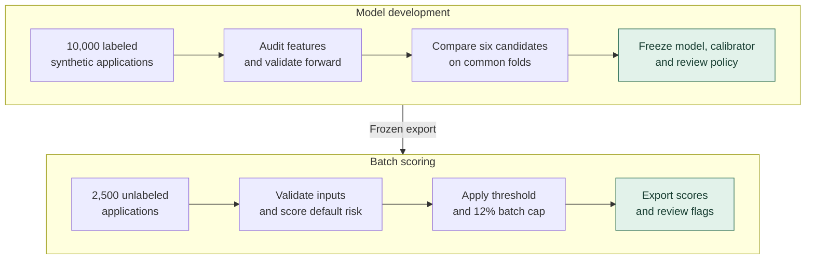

# Tamweel Lite | تمويل لايت

**90-day default risk scoring with a fixed review capacity**

I wanted to see whether information available at application time could help a review team prioritize financing requests. I compared three model families, tightened the validation after finding customer overlap, and turned the final scores into a simulated review queue with a 12% cap. The project uses synthetic applications.

[Executed notebook](notebooks/delivery/NAIF_ALDOSARI_SDA_TAMWEEL_FINAL.ipynb) · [How it works](#how-it-works) · [Project decisions](#project-decisions) · [Presentation](presentation/final_presentation.pdf)

| Result | What I verified | Evidence |
| --- | --- | --- |
| **0.3917 mean Average Precision** | Logistic Regression led six candidates across three forward folds with 2,155 out-of-fold predictions. | [Model comparison](artifacts/ensemble_comparison.csv) |
| **300 of 2,500 routed for review** | The frozen policy stayed within the 12% cap on the unlabeled challenge batch. | [Batch policy](artifacts/final_policy.json) |
| **Every decision reproduced** | Replay reproduced the flags and matched submitted probabilities within `1e-12`. | [Inference and replay](scripts/replay_final.py) |

## How it works

During development, each forward fold uses earlier applications with mature 90-day labels and excludes its validation customers from training. The final sigmoid calibrator is fitted on a reserved set. During scoring, the policy ranks threshold-eligible applications by probability and applies the capacity limit to the complete batch. Equal-score groups stay together at the cap boundary.

## Project decisions

### Baseline model comparison

XGBoost had the best Average Precision on the first split, **0.3338**, compared with **0.3258** for Logistic Regression. I treated that lead as provisional when I found **1,226 customers** on both sides of the split. [Baseline comparison](artifacts/day1_model_comparison.csv)

### Time-aware validation and tuning

I removed two fields collected after application, `collection_calls` and `days_past_due_60`. Mean AP dropped from **0.9988 to 0.3110** across the leaky and clean random controls. I then ran three forward folds with zero shared customers, keeping tuning and preprocessing inside their designated training data. [Leakage audit](artifacts/leakage_audit.csv) · [Fold audit](artifacts/fold_audit.csv)

### Review policy and capacity

A cutoff of 0.5 sent **23.20%** of the busiest development period to review. I swept thresholds for the weighted LightGBM and picked **0.65835**, the lowest-cost cutoff that met the 12% ceiling in every development period. That cutoff belongs to the LightGBM policy study. The exported Logistic Regression has its own threshold. [Decision card](reports/DECISION_CARD.md)

### Model interpretation and calibration

I used SHAP and permutation importance to inspect the exploratory LightGBM. Both pointed to `bureau_score` as the feature the model relied on most. Sigmoid calibration improved Brier from **0.1130 to 0.0671** on that study’s later evaluation split. The diagnostic review queue still exceeded capacity in both evaluation quarters. [Interpretability report](reports/INTERPRETABILITY_REPORT.md)

### Final model and inference

I kept Logistic Regression because it led the final forward folds on mean AP (**0.3917**) and had the lowest mean Brier and calibration error. The weighted blend was the strongest ensemble at **0.3877** AP. The 330 threshold-eligible challenge applications were reduced to **300** review flags by the batch cap. [Ensemble decision](reports/ENSEMBLE_DECISION.md) · [Model card](reports/MODEL_CARD.md)

**Limits.** The challenge batch is unlabeled and supports checking inference and queue capacity. The final sigmoid’s fit-set Brier went from **0.0765 to 0.0781**, so its benefit on new Logistic Regression scores remains unverified. The output represents simulated human-review routing.

## Repository map

| Path | What I use it for |
| --- | --- |
| [`notebooks/`](notebooks) | Executed stage notebooks and the combined walkthrough |
| [`reports/`](reports) | Decision card, interpretability report, model card and [figure index](reports/FIGURES.md) |
| [`data/`](data) and [`artifacts/`](artifacts) | Synthetic inputs, data contract, fold evidence and the frozen model and policy |
| [`tamweel/`](tamweel) and [`scripts/`](scripts) | Probability inference, batch policy and replay checks |
| [`submission/`](submission) | Scored CSV, reproducibility manifests and project bundle |

## Reproduce

1. Open the combined notebook in Colab with a CPU runtime and run it from the top with `FAST_MODE=True`. It uses seed `211` and pinned inputs. If setup restarts the runtime, run from the top again.
2. Compare the saved [model ranking](artifacts/ensemble_comparison.csv), [batch policy](artifacts/final_policy.json) and [submission CSV](submission/submission.csv). The inference entry point writes probabilities. Replay applies the frozen policy to the complete batch and checks the flags.
3. Run the last notebook cell for the repository check. It prints the status and writes a JSON report to Colab Files. [Official Notebook 99](notebooks/99_final_submission_check.ipynb) · [GitHub verification workflow](https://github.com/na2faldosari/NAIF-ALDOSARI-SDA-TAMWEEL/actions/workflows/final_project.yml)

## References

I developed this capstone for the Advanced Machine Learning Methods course (SDA-DSC-211) at SDAIA Academy. The synthetic data, starter notebooks and assessment tools are credited to Meaad Al-Marri and the course materials. [SDAIA Academy on GitHub](https://github.com/SDAIAAcademy) · [Course portal](https://almiyead-rgb.github.io/advanced-machine-learning-methods-sda-dsc-211/) · [Template attribution](https://github.com/almiyead-rgb/sda-dsc-211-student-template/blob/main/NOTICE.md)

Course assessment record

## الإجابات اليومية

### 1. Why XGBoost was a provisional choice

I picked XGBoost for now. Only 7.9% of the requests in the comparison set defaulted, so I paid more attention to how well each model ranked those cases. XGBoost had the highest Average Precision at 0.3338, just ahead of Logistic Regression at 0.3258. The gap was small, so I treated the choice as provisional.

**Why I changed the validation.** The initial split separated application rows, but 1,226 customers appeared in both development and comparison. I used LightGBM as a fixed model to test changes in time ordering and customer separation. The original comparison remains a baseline for that split.

### 2. How I prevented leakage

I found that `collection_calls` counted contacts made after the application. I removed it and `days_past_due_60` because neither was known when the applicant applied. The leaky random control scored 0.9988 mean AP, compared with 0.3110 for the clean random control. The clean run also learned its imputation medians inside training. For the later validation windows, I excluded those customers from training and used only earlier applications whose 90-day outcome window had already closed. All three folds had zero shared customers.

### 3. Why the review threshold changed

I moved the review threshold above 0.5 because the weighted model sent 1,005 of 5,039 applications to review at that cutoff. The busiest period reached 23.20%, well above the 12% ceiling. I chose 0.65835 (rounded) because it gave the lowest simulated loss among the thresholds that met the ceiling in every period. It flagged 526 applications and produced 2,639 loss units, 236 more than 0.5. Missing a default costs ten times as much as a false flag under this cost model, so limiting the queue means accepting more missed defaults. Each flag sends an application to simulated review.

### 4. What the feature effects tell me

`bureau_score`, the synthetic credit score available at application time, was the most important feature in my explanation. It had the largest mean absolute SHAP value across 300 evaluation applications (0.9042 raw log-odds). Shuffling it also caused the largest average drop in Average Precision (0.1270). Both results show how much the fitted model relied on the score. They do not show that changing the score would change someone's default risk. Credit score can reflect other correlated factors, and the analysis did not test an intervention.

### 5. Why Logistic Regression was selected

I kept Logistic Regression because it had the highest mean Average Precision across the three forward folds (0.3917) and the lowest mean Brier score (0.0633) and ECE (0.0188). The strongest ensemble was the weighted blend at 0.3877 AP, 0.0040 below Logistic Regression. The Worth-It Gate required an AP gain greater than the best single model’s fold standard deviation (0.0298), plus limits on worsening calibration. None of the ensembles improved AP, so there was no measured gain to justify the extra models. These folds supported model selection. The unlabeled challenge batch was used to verify the export and review-cap policy.

