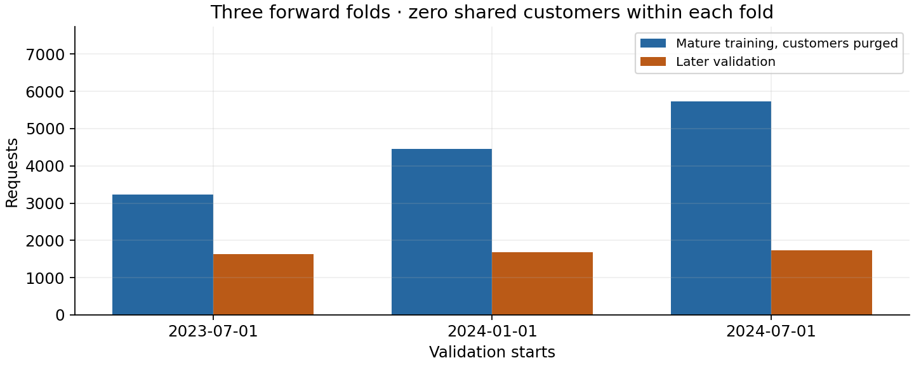
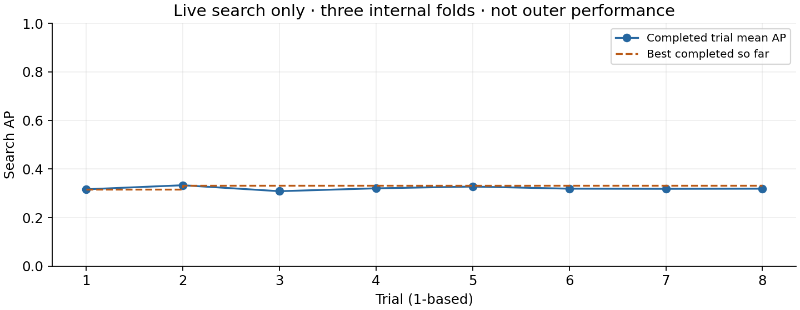
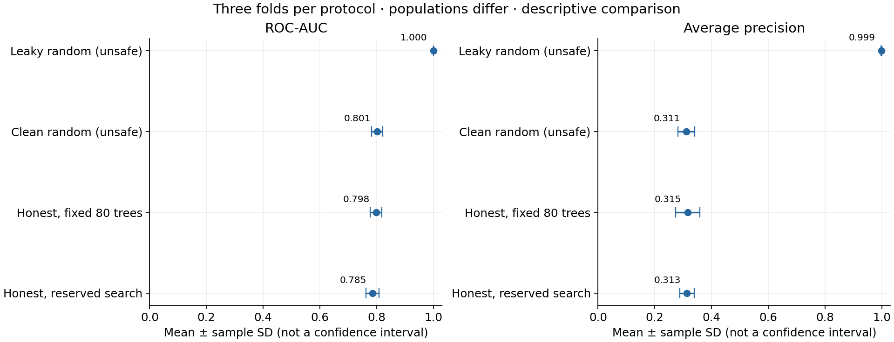

# Day 2 validation report | تقرير التحقق

Day 2 tested LightGBM on later applications from customers held out of each training fold. The feature audit removed `collection_calls` and `days_past_due_60` because their values became available after the application. The audit retained 22 application-time predictors and 10,000 synthetic applications. [Leakage audit](../../artifacts/leakage_audit.csv) · [Executed notebook](../../notebooks/NAIF_ALDOSARI_SDA_TAMWEEL_DAY_02.ipynb)

## Time and customer splits

| Validation starts | Eligible training applications | Validation applications | Shared customers |
| --- | ---: | ---: | ---: |
| July 2023 | 3,223 | 1,632 | 0 |
| January 2024 | 4,460 | 1,674 | 0 |
| July 2024 | 5,731 | 1,733 | 0 |

The training set grows as more 90-day outcomes become available. For each fold, every training label was available before the validation start date. Each honest model produced predictions for all 5,039 eligible validation applications, covering 50.39% of the full dataset. [Fold audit](../../artifacts/fold_audit.csv)

## Optuna search

All eight trials completed on a reserved pool of 1,935 historical applications. The best internal mean Average Precision was **0.3333** at trial `1`, the second plotted attempt. The selected settings were a learning rate of `0.0853` (rounded), `31` leaves, and `40` minimum child samples. The search excluded all outer-validation customers. [Optuna trial history](../../artifacts/optuna_results.csv)

## Validation results

The fixed LightGBM scored **0.3153 AP** and **0.7976 ROC-AUC** on the three forward folds. The tuned version scored **0.3133 AP** and **0.7855 ROC-AUC** on the same folds. The tuned run had lower variation in AP. The error bars show the sample standard deviation of the three fold scores.

The two random protocols are diagnostic controls. Their AP gap of **0.6879** covers two changes together: removing post-application information and fitting imputation on training rows. Clean random and forward validation cover different applications. The forward results support comparison of the two LightGBM configurations under this lab's synthetic setup. [Validation summary](../../artifacts/validation_summary.csv)

[Back to project overview](../../README.md#day-2-results)
